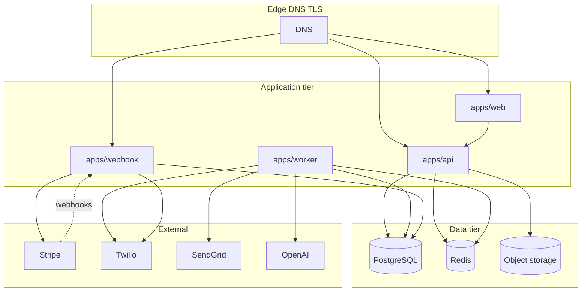

# FS-83 — Critical services, data, and recovery order

**Scope:** Provider-neutral inventory from repository layout, `@fsm/config` env schema, and `docs/planning/PRODUCTION-DEPLOYMENT.md` (treat deployment doc as **planning hypothesis** until FS-93 verifies live accounts).

**Evidence class:** `repo-derived` unless marked `account-unknown`.

---

## 1. Application runtimes

| ID | Component | Package / entry | Role | Criticality | Recovery notes |
|---|---|---|---|---|---|
| R1 | Operator web | `apps/web` (Next.js 14) | UI, server components, public branded routes | **P0** | Redeploy from verified artifact; depends on API URL and auth cookies |
| R2 | API | `apps/api` (`buildApp`) | Auth, tenant context, domain services, uploads | **P0** | Stateless; scale horizontally after DB/Redis/storage healthy |
| R3 | Worker | `apps/worker` | BullMQ consumers, cron-style repeat jobs | **P0** | Must not start until Redis + DB ready; queue depth reconciled after restore |
| R4 | Webhook ingress | `apps/webhook` | Stripe, Twilio signature-verified callbacks | **P0** | Requires `STRIPE_WEBHOOK_SECRET`, Twilio auth; DNS must route to this service |

Shared libraries: `packages/db`, `packages/jobs`, `packages/types`, `packages/ai`, `packages/config`, `packages/ui`.

---

## 2. Data stores and queues

| ID | Store | Code / env | Durability class | Criticality | Backup owner (until FS-93) |
|---|---|---|---|---|---|
| D1 | PostgreSQL | `DATABASE_URL`, Drizzle `packages/db` | **Authoritative SoR** — customers, jobs, money, events, agents | **P0** | `account-unknown` — FS-80 configures encrypted backups |
| D2 | Redis | `REDIS_URL`, BullMQ prefix `fsm` | **Ephemeral + operational** — queues, repeat job schedules, rate limits | **P1** | Rebuild from empty acceptable if jobs reconciled; document job loss window in RPO discussion |
| D3 | Object storage | R2 via `@fsm/config/storage` (`R2_*`) | **Binary SoR** for uploads | **P0** | **Separate** from D1; FS-83 / FS-85 |

### PostgreSQL domains (tenant-scoped via `companyId`)

High-value tables for recovery verification (not exhaustive):

- **Identity / tenancy:** `companies`, `users`, `refresh_tokens`
- **Commercial graph:** `customers`, `properties`, `assets`, `jobs`, `estimates`, `invoices`, `payments`, `maintenance_plans`
- **Agent / audit:** `activity_events`, `agent_actions`, `ai_recommendations`
- **Comms / imports:** `message_logs`, `import_sessions`, `campaigns`
- **Files (metadata):** `file_attachments`, `job_photos` (URLs point to D3)

All application queries must filter `companyId` and soft-delete (`deletedAt`); drill must validate no cross-tenant rows after restore.

### BullMQ queues (`packages/jobs/src/queues.ts`)

| Queue | Name | Primary workloads |
|---|---|---|
| Q1 | `fsm:imports` | CSV import mapping and ingestion |
| Q2 | `fsm:ai` | Revenue AI, dormant scan, revenue summary cron |
| Q3 | `fsm:notifications` | SMS/email dispatch |
| Q4 | `fsm:invoices` | Invoice reminder escalation |
| Q5 | `fsm:agreements` | Service agreement renewals |
| Q6 | `fsm:webhooks` | Outbound webhook delivery (future) |
| Q7 | `fsm:operator` | Retention gates / operator workflows |

Worker registers processors for Q1–Q5 and Q7; Q6 defined but verify consumers at drill head.

---

## 3. External dependencies

| ID | Provider | Env keys | Inbound to Renvani | Outbound from Renvani | Payment / PII |
|---|---|---|---|---|---|
| E1 | Stripe Connect | `STRIPE_*` | Webhook app (`apps/webhook`) | API/services | **Money** — reconcile with `payments`, `maintenance_plans.stripeSubscriptionId` |
| E2 | Twilio | `TWILIO_*` | Webhook app | Worker notifications | PII — consent-gated |
| E3 | SendGrid | `SENDGRID_*` | — | Worker notifications | PII |
| E4 | OpenAI | `OPENAI_API_KEY` | — | Worker / AI package | Prompt content — redacted logs |
| E5 | Cloudflare R2 | `R2_*` | — | API storage adapter | Customer files |
| E6 | DNS / TLS / edge | Not in env schema | Public HTTP | — | `account-unknown` — FS-78 family |

Auth is **custom JWT** (`JWT_SECRET`, `JWT_REFRESH_SECRET`) — not a third-party IdP in env schema.

---

## 4. Domains and public surfaces (planning)

From `PRODUCTION-DEPLOYMENT.md` (unverified until FS-93):

| Surface | Planned host | Consumer |
|---|---|---|
| Marketing / app web | `servicerev.app`, `app.servicerev.app` | R1 |
| API | `api.servicerev.app` | R2, R1 |
| Files | `files.servicerev.app` (R2 public URL) | D3 signed/public access |
| Webhooks | Dedicated webhook service URL | R4 |

Drill must include **DNS/edge smoke** only in isolated drill DNS or provider sandbox — not production cutover.

---

## 5. Dependency graph (runtime)

---

## 6. Recovery order (recommended)

Restore and validate in this order to avoid cascading corruption or double side effects.

| Phase | Step | Components | Rationale |
|---|---|---|---|
| **0** | Isolate | Network, credentials | No production traffic; drill-only secrets (FS-75, FS-76) |
| **1** | Secrets baseline | E1–E5 drill keys | Apps fail fast without `@fsm/config` validation |
| **2** | PostgreSQL restore | D1 | SoR for metadata, money, tenancy, events |
| **3** | Schema/migration verify | D1, `packages/db` migrations | FS-80 migration policy; `drizzle-kit` version at drill head |
| **4** | Object storage restore or re-link | D3 | Metadata in PG without blobs is a partial recovery |
| **5** | Redis | D2 | Empty start acceptable; flush stale keys if restoring RDB/AOF per FS-93 |
| **6** | API deploy + health | R2 | Validates DB pool, env, read paths |
| **7** | Webhook deploy (paused ingress) | R4 | Prevent external events until reconciliation done |
| **8** | Reconciliation SQL + payment checks | D1, E1 | See drill checklist |
| **9** | Worker deploy (reduced concurrency) | R3, Q1–Q7 | Drain or pause queues; replay idempotent jobs only after sign-off |
| **10** | Web deploy | R1 | Operator smoke tests |
| **11** | Enable webhook ingress + provider sandboxes | R4, E1–E3 | Stripe/Twilio test mode only until PO authorizes |
| **12** | Edge/DNS validation | DNS | Point drill hostnames only |

**Role ownership (default until RACI updated):**

| Role | Phases |
|---|---|
| Platform / Infrastructure | 0–1, 5–7, 10–12 |
| Backend (Pair 2 / FS-80) | 2–3 |
| Backend (FS-85) | 4 |
| Security + QA 2 | 8, 11 negatives |
| Product Owner | Approve RPO/RTO and drill go/no-go |

---

## 7. Unknowns (must not be assumed)

- Live backup retention, PITR, and off-site copy cadence for D1 and D3.
- Whether Redis persistence is enabled in production.
- Actual hosting mapping (Railway/Vercel vs FS-93 alternatives).
- Whether production webhook endpoints overlap with drill URLs.
- Stripe Connect account recovery and platform dashboard access (founder-held).

Mark each unknown resolved in FS-93 evidence before claiming recovery readiness.
