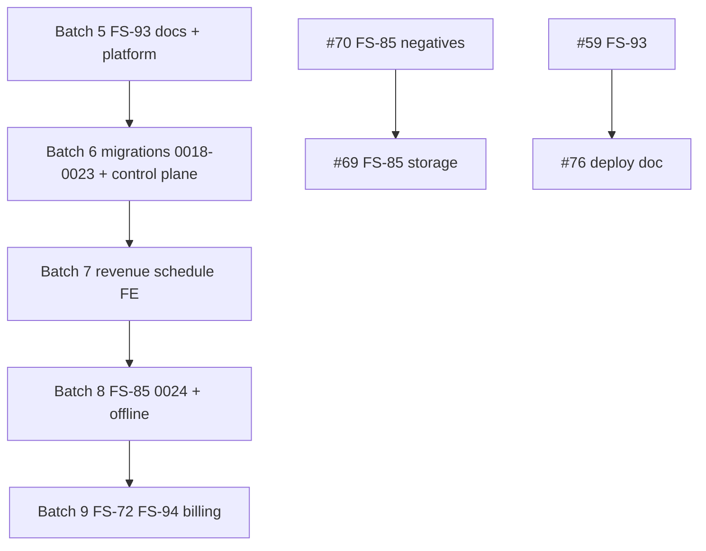

# Renvani batch plan — Batches 5–9 (autonomous execution)

**Authority:** Founder standing orders 2026-10-22 5:26 PM CT (relay E.. CoS)  
**Tech Lead:** Grace (`bc-f58c7cfc-d866-4f13-bbbb-b95c96ea1f27`) — autonomous batch-to-batch for **5 batches** (no per-batch founder/CoS wait; Shaun pre-approved CI + merge to `dev`)  
**Product Owner:** Elena (`bc-0da9c117-da01-40c1-9d2a-29957eaa548f`) — scope and acceptance alignment  
**Integration base (planning):** `dev` @ `7c41d2dc282b14ef04c714a406ff9642c1e6b145` (dispatch 2026-10-22 UTC)  
**Hard rules:** no rebase, no force-push, new commit voids sign-offs; never touch `main`; no deploys; no account/credential/resource creation; no live payments or real-customer sends; no Render/Vercel/R2 **provisioning** (FS-93 architecture/docs only until Shaun OK).

**Reporting:** E.. CoS only at each batch merge (PR list + merge SHAs) or a real blocker.

---

## 1. Roster (FS-91 + pods)

### Senior developer pairs (implementation owners)

| Pair | Devs | Primary lanes |
| --- | --- | --- |
| **1** | **Ava** (A) + **Marcus** (B) | Backend — identity/session (FS-84), control plane (FS-12/13 support) |
| **2** | **Priya** (C) + **Leo** (D) | Backend — DB ops (FS-80), revenue/scheduling APIs (FS-17, FS-87), migrations |
| **3** | **Sofia** (E) + **Omar** (F) | Backend — isolation (FS-92), media/export (FS-85, FS-89), growth workers |
| **4** | **Ben** (G) + **Nina** (H) | Infra — staging matrix (FS-75), runtime health (FS-79), recovery (FS-83), command center hooks |
| **5** | **Diego** (I) + **Hana** (J) | Infra — secrets/env (FS-76), queues/DLQ (FS-81), branch protection (FS-74) |

### Backend pods (parallel capacity — same pair tickets, split file ownership)

| Pod | Lead | Pair anchor | Focus |
| --- | --- | --- | --- |
| **Backend 1** | **Noah** | Pair 1 | Auth/session services, FS-84 negatives, FS-12 state machine API |
| **Backend 2** | **Aria** | Pair 2 | Transactions, FS-80 helpers, FS-87 sync contracts, migration safety |
| **Backend 3** | **Kai** | Pair 3 | FS-92 proof tests, FS-85/89 storage boundaries, worker idempotency |

### Infrastructure pods

| Pod | Lead | Pair anchor | Focus |
| --- | --- | --- | --- |
| **Infra 1** | **Mila** | Pair 4 | FS-75/79 staging+runtime docs, FS-83 RPO/RTO, observability hooks |
| **Infra 2** | **Ezra** | Pair 5 | FS-76/74/81 runbooks, CI/batch-ci wiring docs, queue policy |
| **Infra 3** | **Iris** | Tech Lead + Pair 4/5 | FS-93/Render reconciliation, migration registry, cross-batch merge order |

### Frontend / design (batch-balanced slices)

| Role | Dev | Typical PRs |
| --- | --- | --- |
| Workflow & web | **Dev E** (legacy roster) / **Marcus** co-own | FS-31 branded acquisition, booking/inquiry UX hardening |
| Acquisition web | **Dev D** / **Leo** co-own | FS-38/17 public flows, growth surfaces |
| Operator UI | **Dev G** / **Ben** co-own | FS-14 command center, FS-55/53 growth UI |
| Design | Designer 1 + 2 | FS-9/47/48 alignment (non-blocking for infra batches) |

### Review, QA, Security (exact-head sign-off)

| Function | Names | Rule |
| --- | --- | --- |
| **Reviewer** | Isaac, Chloe, Victor (rotate per PR) | Architecture/API contract; posted GitHub comment @ full head SHA + agent id |
| **QA** | Lily, Jamal, Zoe, Owen | Commands + UI matrix where applicable; comment @ head SHA |
| **Security** | Sam (`bc-3826ae19-3f55-4c04-aa04-de68bf25cc0a`) | Mandatory for tenant/auth/secrets/money/media; comment @ head SHA |

**Sign-off void:** any new commit on the PR branch before merge.

---

## 2. SQL migration authority

**Registry:** `docs/platform/MIGRATION_NUMBERING_REGISTRY.md` (on PR #59 branch until merged; Tech Lead maintains on `dev` after #59).

| Slot | Assignment | PR |
| --- | --- | --- |
| 0018–0019 | FS-55 growth check | #52 |
| 0020 | FS-17 inquiry idempotency | #53 |
| 0021 | FS-14 agent action params | #55 |
| 0022 | FS-53 growth intake | #56 |
| **0023** | **FS-87 field work sync** | **#75** (renumber from `0018_field_work_sync` — new commit only) |
| **0024** | *Reserved — Batch 6* | FS-85 storage schema (PR #69) — **request before generate** |
| **0025** | *Reserved — Batch 7* | FS-94 subscription billing (new PR) |
| **0026+** | Unallocated | Tech Lead only |

**Merge rule:** Within a batch, merge SQL-bearing PRs in **ascending idx** after all non-SQL PRs in that batch unless registry says otherwise.

---

## 3. Batch execution pipeline (each batch)

1. Open or refresh all batch PRs (target 8–10), assign pair + pod leads, migration slots declared in PR description.
2. Reviewer + QA + Security (if applicable) sign at **exact full head SHA** in GitHub PR comments.
3. When **all** batch PRs are open and Security-signed (where required), **start next batch** work in parallel (prep branches only; do not merge batch N+1 until batch N lands).
4. When batch is fully signed: add `batch-ci` label → wait green → mark ready → merge to `dev` in **migration order** with head SHA guard on merge commit message.
5. Post merge summary to E.. CoS (PR numbers + merge SHAs).

---

## 4. Carryovers into Batch 5 (mandatory)

| PR | Ticket | Gate |
| --- | --- | --- |
| [#59](https://github.com/SimonShaun2/Renvani/pull/59) | FS-93 | Docs fully signed; merge early in batch |
| [#76](https://github.com/SimonShaun2/Renvani/pull/76) | FS-93 deployment doc | After #59; Isaac CHANGES addressed @ `d344786…` |
| [#75](https://github.com/SimonShaun2/Renvani/pull/75) | FS-87 | **Renumber to `0023_field_work_sync`** — done @ `79daecd…` (Batch **6** merge) |
| [#54](https://github.com/SimonShaun2/Renvani/pull/54) | FS-72 spec | **Security** sign-off required |
| [#69](https://github.com/SimonShaun2/Renvani/pull/69) | FS-85 storage | Merge **after** [#70](https://github.com/SimonShaun2/Renvani/pull/70) |
| Batch 4 failures | — | Any open Batch 4 PR that fails `batch-ci` is **re-cut** (new commit) and slotted into Batch 5 or 6 — no force-push |

---

## 5. Batch definitions (5–9)

### Batch 5 — `BATCH-FS5-FOUNDATION-004`

**Theme:** Close FS-93 documentation; platform footings (no cloud provisioning); runtime health + secrets + staging **design**.

| # | PR | Ticket | Layer | Owner | Reviewer | QA | Sec |
| --- | --- | --- | --- | --- | --- | --- | --- |
| 1 | #59 | FS-93 | Infra/docs | Iris + Grace | Victor | Owen | Sam |
| 2 | #76 | FS-93 deploy doc | Infra/docs | Iris | Isaac | Lily | Sam |
| 3 | #47 | FS-41 | Docs/platform | Grace | Chloe | Jamal | — |
| 4 | #68 | FS-76 | Infra | Diego+Hana / Ezra | Isaac | Zoe | Sam |
| 5 | #65 | FS-74 | Infra | Diego+Hana | Victor | Owen | — |
| 6 | #64 | FS-83 | Infra | Ben+Nina / Mila | Chloe | Lily | — |
| 7 | #71 | FS-79 | Infra/API | Ben+Nina / Mila | Isaac | Jamal | Sam |
| 8 | #61 | FS-75 | Infra | Ben+Nina | Victor | Zoe | Sam |
| 9 | #63 | FS-80 | Backend | Priya+Leo / Aria | Chloe | Owen | Sam |
| 10 | #54 | FS-72 spec | Product/docs | Nina + Elena | Victor | — | Sam |

**Not in Batch 5 merge:** #75 (0023) until renumber verified; #69 until #70 merged.

**Balance:** ~4 infra docs + 4 infra/runtime + 2 backend/docs.

---

### Batch 6 — `BATCH-FS6-GROWTH-CONTROL-005`

**Theme:** Growth migration chain + agent control plane + identity/isolation proofs.

| # | PR | Ticket | Layer | Owner | Migration |
| --- | --- | --- | --- | --- | --- |
| 1 | #52 | FS-55 | BE+worker | Sofia+Omar / Kai | 0018–0019 |
| 2 | #53 | FS-17 | BE+web | Priya+Leo / Aria | 0020 |
| 3 | #55 | FS-14 | BE+web | Ben+Nina + Dev G | 0021 |
| 4 | #56 | FS-53 | BE | Sofia+Omar | 0022 |
| 5 | #48 | FS-12 | BE | Ava+Marcus / Noah | — |
| 6 | #51 | FS-13 | BE | Ava+Marcus | — |
| 7 | #62 | FS-84 | BE | Ava+Marcus / Noah | — |
| 8 | #67 | FS-92 | BE/tests | Sofia+Omar / Kai | — |
| 9 | #43 | FS-10 | BE | Priya+Leo | — |
| 10 | #75 | FS-87 | BE | Priya+Leo / Aria | **0023** |

**Balance:** 6 backend, 2 frontend-heavy, 2 worker/growth.

---

### Batch 7 — `BATCH-FS7-REVENUE-SCHEDULE-006`

**Theme:** Branded acquisition, scheduling agent, queues, export.

| # | PR | Ticket | Layer | Owner |
| --- | --- | --- | --- | --- |
| 1 | #49 | FS-31 | Frontend+API | Dev E + Marcus |
| 2 | #50 | FS-23 | BE+web | Dev H + Ben |
| 3 | #73 | FS-89 | BE | Sofia+Omar / Kai |
| 4 | #74 | FS-81 | Infra/worker | Diego+Hana / Ezra |
| 5 | #70 | FS-85 negatives | BE/tests | Sofia+Omar |
| 6 | *new* | FS-38 web hardening | Frontend | Dev D + Leo |
| 7 | *new* | FS-21 hold follow-up | BE+web | Dev F + Pair 3 |
| 8 | *new* | FS-58 proxy hardening | BE+web | Pair 3 |
| 9 | *new* | Cloud Agent env notes #60 | Docs | Iris |

**Balance:** 3 FE-facing, 4 BE, 2 infra/docs.

---

### Batch 8 — `BATCH-FS8-MEDIA-OFFLINE-007`

**Theme:** Tenant-safe media, offline sync UX, recovery drill evidence.

| # | PR | Ticket | Layer | Owner | Notes |
| --- | --- | --- | --- | --- | --- |
| 1 | #69 | FS-85 storage | BE | Sofia+Omar | **After #70**; migration **0024** |
| 2 | *new* | FS-87 mobile client contract | BE/docs | Priya+Leo | Consumes 0023 |
| 3 | *new* | FS-83 drill automation | Infra | Mila | Docs + CI checks only |
| 4 | *new* | FS-82 capacity qualification | QA+Platform | Ezra + Owen | Test plan + thresholds |
| 5 | *new* | FS-9 inquiry copy alignment | Frontend | Dev E + Designer 1 | FS-38 checklist |
| 6 | *new* | Dispatch SSE fallback | BE+web | Ben + Dev G | Per BUILD_LAYERS |
| 7 | *new* | Worker graceful shutdown follow-up | Infra | Diego | FS-79 related |
| 8 | *new* | FS-4 TrayLoop inventory refresh | Docs | Grace | Inform only |

---

### Batch 9 — `BATCH-FS9-RETENTION-BILLING-008`

**Theme:** Loyalty/maintenance plans (FS-72), platform billing (FS-94), subscription webhooks design.

| # | Work | Ticket | Layer | Owner |
| --- | --- | --- | --- | --- |
| 1 | Implement FS-72 from #54 spec | FS-72 | BE+worker+web | Pair 4 + Dev G |
| 2 | FS-94 Renvani→operator billing | FS-94 | BE+webhook | Priya+Leo / Aria |
| 3 | FS-88 operator→customer payments boundary doc | FS-88 | Docs | Grace + Sam |
| 4 | FS-94 migration | — | DB | **0025** reserved |
| 5 | Maintenance plan UI slice | FS-72 | Frontend | Dev E |
| 6 | Stripe webhook matrix update | FS-94 | Infra/docs | Iris |
| 7 | FS-92 staging re-run post-FS-85 | FS-92 | Tests | Kai |
| 8 | FS-35 pilot rubric tie-in | FS-35 | Product | Elena |

**Balance:** 3 BE, 2 FE, 2 docs/infra, 1 product.

---

## 6. Notion board alignment (Ready / In Progress)

**Pulled 2026-10-22 UTC** from Field Service Build Board:

- **Ready (true):** FS-4 TrayLoop inventory, FS-6 design partners (GTM — not in engineering batches 5–9 unless Elena pulls in).
- **In Progress / staged (Batch 4 carry):** FS-12, FS-13, FS-14, FS-17, FS-23, FS-31, FS-41, FS-53, FS-55.
- **Platform In Progress:** FS-75, FS-76, FS-80, FS-84, FS-92, FS-93 (In Review).

**PO action (Elena):** Set `CI Batch` on cards to `BATCH-FS5-FOUNDATION-004` … `BATCH-FS9-RETENTION-BILLING-008` as batches dispatch; keep FS-6/FS-4 Ready items out of engineering merge trains unless explicitly added.

---

## 7. Dependencies (do not merge out of order)

---

## 8. Autonomous execution start (Grace — immediate)

1. **Batch 5:** Chase Security + Reviewer + QA sign-offs on #59, #76, #54; confirm #75 renumber commit on #75; hold #69.
2. **Parallel prep:** Batch 6 owners rebase **via new commits** onto post–Batch-5 `dev` (no force-push); declare migration slots in PR bodies.
3. **Migration registry:** Land registry from #59 with Batch 5; update **0024+** reservations as PRs open.
4. **Do not** provision staging or cloud resources until Shaun OK (FS-75 remains design/matrix).

---

## 9. Document history

| Date | Change |
| --- | --- |
| 2026-10-22 | Initial Batches 5–9 plan — Grace + Elena (founder 5:26 PM CT standing orders) |
| 2026-10-22 | Notion: [Batches 5–9 plan](https://app.notion.com/p/401317b92d1581f7bf59f91174e32f43); docs PR [#78](https://github.com/SimonShaun2/Renvani/pull/78) |
