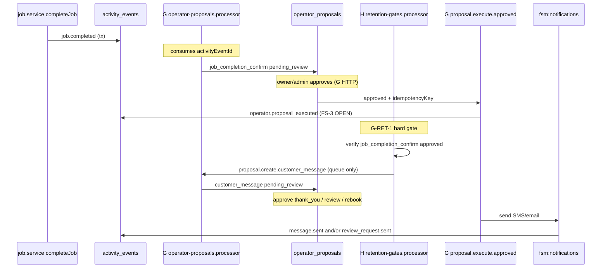

# FS-39 — Dev H service event map (completion → retention proposals)

**Parent artifact:** `FS-39-dev-H-service-workflows-handoff.md`  
**Aligned with:** `operator-inbox-ui@0.1.0`, **`fsm.pair4.proposal-factory@0.1.2`** (Pair 4 joint locked)  
**Base SHA:** `12b23226c0e0c199626940117fc7f0fa89f87375`  
**Status:** **Preflight CLOSED** (spec only) — **no implementation** while FS-3, FS-8, FS-9 blocked  
**Date:** 2026-10-20 (UTC); closure pass 2026-10-20 (UTC)

---

## 0.1 Hard gate G-RET-1 (staff-confirmed completion)

**No retention/review/rebook `customer_message` create, approve, or execute without an approved `job_completion_confirm` for the same `jobId`.** `job.completed` alone is insufficient.

| Step | Gate | Fails closed |
|------|------|--------------|
| H retention-gates enqueue | `prerequisiteProposalId` → row `kind=job_completion_confirm` AND `status=approved` (or execute-derived from it) | No queue job; optional `retention.follow_up.blocked` event |
| G `proposal.create.customer_message` | Re-validate G-RET-1 + Zod metadata | No insert |
| G approve/execute `customer_message` | Re-validate prerequisite still approved; job not reopened (**OPEN**) | 409 / no send |

See `FS-39-pair4-proposal-factory-v0.1.2.md` §1.

---

## 0.2 Job vs visit vs series (anchors)

| Layer | Store | Completion signal for Pair 4 | Retention anchor |
|-------|--------|------------------------------|------------------|
| **Job** | `jobs.status` (`job_status` enum) | `activity_events.job.completed` | **Required** — all proposals use `entityLinks.jobId` |
| **Visit** | `maintenance_visits` (`completed_date`, `job_id`) | `maintenance_visit.completed` (enum exists; emission **OPEN**) | Optional link only; v1 gates on **job** |
| **Series** | `maintenance_plans.status` | Not a completion gate (no visit-series generator at base SHA) | Optional `entityLinks.maintenancePlanId` for attribution |

**v1 out of scope:** retention when a visit completes with no linked job (FS-3+).

---

## 0. End-to-end flow (target state)



**Today at base SHA:** only the `API → AE: job.completed` step and `aiQueue` side effect exist; no operator proposals; `createReviewRequest` can bypass this chain (legacy risk).

---

## 1. Stage map (H-side service semantics)

| Stage | What happens | Authority | Existing today |
|-------|----------------|-----------|----------------|
| S0 | Tech/operator calls `POST /jobs/:id/complete` | `job.service.completeJob` | Yes |
| S1 | `jobs.status` → `completed`, rollups | Same tx | Yes |
| S2 | Emit **`job.completed`** | `emitJobEvent` → `activity_events` | Yes |
| S3 | Enqueue `evaluate-revenue-opportunities` | `aiQueue` (post-tx) | Yes |
| S4 | G factory: `proposal.create.from_activity_event` | **G** worker | **No** |
| S5 | Insert `job_completion_confirm` proposal | **G** `operator-proposal.service` | **No** |
| S6 | Staff approve completion confirm | **G** HTTP | **No** |
| S7 | H: **G-RET-1** + automation/consent precheck | **H** `retention-gates.processor` | **No** |
| S8 | H enqueue `proposal.create.customer_message` (only if S6 approved) | **H** → **G** factory | **No** |
| S9 | Staff approve `customer_message` | **G** HTTP | **No** |
| S10 | G execute → notifications → send | **G** worker | Partial (`send-review-request` exists without proposal) |

---

## 2. Existing activity event types & row fields (base SHA)

**Table:** `activity_events` (`packages/db/src/schema.ts` ~L993–1022)

| Column | Type | Notes |
|--------|------|--------|
| `id` | UUID | **Canonical `sourceEventIds` reference** |
| `companyId` | UUID | Tenant scope — required on every read |
| `eventType` | `activity_event_type` enum | See §2.1 |
| `actorId` | UUID nullable | Completing user on `job.completed` |
| `actorType` | varchar default `user` | |
| `actorName` | varchar nullable | Denorm display |
| `entityType` | varchar | `job` for completion |
| `entityId` | UUID | `jobs.id` |
| `customerId` | UUID nullable | Set on job events |
| `jobId` | UUID nullable | Set on job events |
| `estimateId` / `invoiceId` | UUID nullable | Usually null on completion |
| `payload` | jsonb default `{}` | **Extensible after FS-3** |
| `summary` | text | Human timeline string |
| `occurredAt` | timestamp | Default now |

**Emit API:** `emitEventWithExecutor` / `EmitEventContext` (`packages/db/src/events.ts`) — insert does **not** return row id to callers today (**OPEN:** FS-25 bridge must capture `id` via `.returning()` or follow-up query).

### 2.1 Job-related enum values (existing)

From `activityEventTypeEnum` (`schema.ts` ~L233–250):

| `eventType` | Emitter (today) | Typical `entityType` |
|-------------|-----------------|----------------------|
| `job.completed` | `job.service.completeJob` | `job` |
| `job.task_completed` | `job-tasks.service.completeTask` | `job` |
| `job.updated` | notes/photos/patch | `job` |
| `job.started` | status transition | `job` |
| `job.reopened` | transition from cancelled | `job` |
| `review_request.sent` | `review-request.service.createReviewRequest` | `review_request` |
| `review_request.completed` | public complete flow | `review_request` |
| `message.sent` | notification worker (post-send) | **OPEN** entity typing |
| `ai.recommendation_created` | AI revenue (G bridge) | `ai_recommendation` |

**Not in enum today (FS-3 OPEN — G inbox audit):**

`operator.proposal_created`, `operator.proposal_approved`, `operator.proposal_rejected`, `operator.proposal_executed`, `retention.follow_up.blocked` (H blocked-path audit; **OPEN** final names with FS-8 / G).

### 2.2 `job.completed` — exact payload today

**File:** `apps/api/src/services/job.service.ts` ~L1308–1318

```json
{
  "fromStatus": "<JobStatus before complete>",
  "toStatus": "completed"
}
```

**Context columns set:** `customerId`, `jobId` from job row; `actorId` = completing user.

**Proposed additive payload (FS-25 bridge — implementation blocked):**

| Field | Type | Purpose |
|-------|------|---------|
| `activityEventId` | UUID | Self-reference for factories (**requires emit returning id**) |
| `requiredTasksTotal` | number | Denorm for G eligibility |
| `requiredTasksCompleted` | number | |
| `requiredTasksPending` | number | Gate for `job_completion_confirm` |
| `hasCompletionSignature` | boolean | `signatureUrl` or `signedByName` present |
| `checklistComplete` | boolean | **OPEN** PO rule: all required tasks done |

### 2.3 `job.task_completed` — exact payload today

**File:** `apps/api/src/services/job-tasks.service.ts` ~L156–169

```json
{
  "taskId": "<uuid>",
  "title": "<string>"
}
```

**Task row fields for proof:** `job_tasks.is_required`, `job_tasks.status` ∈ `pending | in_progress | completed | skipped` (`job_task_status` enum).

### 2.4 Legacy `review_request.sent` (bypass path — to retire)

**File:** `review-request.service.ts` ~L286–301

```json
{
  "reviewRequestId": "<uuid>",
  "referenceId": "<uuid>",
  "channel": "sms"
}
```

**Target:** FS-28 `touchpointKind: review_request` creates **`customer_message`** proposal first; `review_requests` row + `review_request.sent` only after **G execute** (**OPEN:** whether execute always creates `review_requests` or only sends link — G + PO).

---

## 3. Operator proposal kinds (G contract) in this pipeline

| `OperatorProposalKind` | Created by | `sourceEventIds` (minimum) | H involvement |
|------------------------|------------|----------------------------|---------------|
| `job_completion_confirm` | G `proposal.create.from_activity_event` | `[job.completed.id]` + optional `job.task_completed.id[]` | H enriches `job.completed` payload; H does not insert row |
| `customer_message` + `retention_thank_you` | G factory from H queue (post G-RET-1) | `[job.completed.id]` + optional `job.task_completed.id[]` | H enqueues draft |
| `customer_message` + `retention_issue_check` | Same | Same | Same |
| `customer_message` + `retention_rebook_offer` | Same | Same | Same |
| `customer_message` + `retention_review_request` | Same | Same | Replaces direct `createReviewRequest` |

**`CustomerMessageProposalDraftV1.sourceEventIds` rules (normative):**

1. Must include the **`job.completed`** activity event `id` for the job.
2. Must include **`metadata.prerequisiteProposalId`** (approved `job_completion_confirm` proposal id) — **hard gate G-RET-1**.
3. Should include **`job.task_completed`** ids for each **required** task completed before completion (**OPEN:** include skipped required tasks as negative proof).
4. Must not include cross-tenant ids (factory validates `companyId` on every id).

**Provenance panel (G UI):** maps `sourceEventIds` → timeline fetch; H does not duplicate provenance in brief API.

---

## 4. Completion-proof rules (proposed — pending FS-9/PO)

| Proof level | Definition | Unlocks |
|-------------|------------|---------|
| **P0 Operational** | `jobs.status === completed` AND ∃ `activity_events` row `eventType=job.completed` with `jobId` | G may consider `job_completion_confirm` factory job |
| **P1 Checklist** | `requiredTasksPending === 0` (required tasks not `completed` or `skipped`) | G creates `job_completion_confirm` (**OPEN** skip semantics) |
| **P2 Staff attestation (G-RET-1)** | `job_completion_confirm` proposal `status === approved` | **Required** before any retention `customer_message` enqueue |
| **P3 Outbound** | P2 + `consentScope` + execute-time checks (§5) | G `proposal.execute.approved` → notifications |

**Dispute / reopen (OPEN):** `job.reopened` should cancel pending retention factory jobs and block new drafts until new completion chain — FS-26 / G `exception_escalation`.

**H does not implement P2/P3** — only reads proposal status via **read-only** query API or shared service function owned by **G** (**OPEN:** `operatorProposalService.getApprovedCompletionConfirm(companyId, jobId)` — G exports, H calls).

---

## 5. Tenant & consent guard points

| Guard | When | Owner | Fields / checks (existing schema) |
|-------|------|-------|----------------------------------|
| G1 Tenant scope | Every DB read/write | All | `companyId` from JWT / job row |
| G2 Cross-tenant `sourceEventIds` | G factory create | **G** | Reject if any event `companyId !==` proposal `companyId` |
| G3 Role | Approve/reject/edit HTTP | **G** | `owner`, `admin` (dispatcher read **OPEN** FS-9) |
| G4 `doNotContact` | H precheck + G execute | **H** then **G** | `customers.do_not_contact` |
| G5 SMS preference | H precheck + G execute | **H** then **G** | `customers.prefers_sms` |
| G6 Channel consent | G execute | **G** | `booking_requests.sms_consent_appointments` / `sms_consent_marketing` — **OPEN** PO mapping per touchpoint (review vs thank_you) |
| G7 Automation opt-in | H retention-gates | **H** | `automation_rules.is_enabled` per `ruleType` (`review_request`, `job_follow_up`, etc.) |
| G8 Idempotency | Factory + execute | **G** | `proposal:create:…`, `proposal:execute:…`, approve client UUID (`fsm.pair4.proposal-factory@0.1.2` §3) |
| G8b `attributionKey` | Analytics | **H** draft | `retention:{companyId}:{jobId}:{touchpoint}` in metadata |
| G9 Technician forbid | Approve HTTP | **G** | N6 |

**H blocked path (no proposal row):** emit **`retention.follow_up.blocked`** (enum **OPEN** FS-3) with payload `{ jobId, customerId, touchpointKind, reasonCode, policyVersion }` — never enqueue `proposal.create.customer_message`.

**Precheck vs execute:** H may soft-fail at precheck (no queue); G **must** hard-fail at execute (G1–G6).

---

## 6. Queue & job payloads (target — FS-3)

| Queue | Name | Owner | New? |
|-------|------|-------|------|
| Operator factory + execute | `fsm:operator` (**OPEN** exact name) | G | Yes |
| Notifications | `fsm:notifications` | G execute | Exists |
| AI revenue | `fsm:ai` | H post-complete | Exists |
| Retention evaluate | **`fsm:operator` only** (G locked) | H enqueue; G may trigger | **CLOSED** O9 |

**H retention-gates job (proposed — on `fsm:operator`):**

```typescript
{
  type: "retention.evaluate_after_completion_confirm";
  companyId: string;
  jobId: string;
  prerequisiteProposalId: string;
  sourceActivityEventIds: string[];
}
```

**Triggered:** **OPEN O7** — G on `job_completion_confirm` approve vs poll.

---

## 7. Automation rules touchpoints (existing types)

From `automation_rule_type` (`schema.ts` ~L1248–1254) + defaults (`automation-rule.service.ts`):

| `ruleType` | Default delay | Maps to `touchpointKind` |
|------------|---------------|---------------------------|
| `review_request` | 4h | `retention_review_request` |
| `job_follow_up` | 48h | **OPEN** `retention_thank_you` or `retention_issue_check` |
| (none) | — | `rebook_offer` **OPEN** new rule type or config |

**H retention-gates** reads enabled rules before enqueueing each `customer_message` draft. Delays via **scheduled** factory jobs (**OPEN** scheduler owner: Platform vs G worker).

---

## 8. File ownership after FS-3 / FS-8 (implementation phase)

### 8.1 Migrations & schema (Pair 1 / TL — FS-3)

| Artifact | Owner |
|----------|--------|
| `operator_proposals`, `operator_proposal_versions` tables | Pair 1 |
| `activity_event_type` enum additions | Pair 1 |
| `packages/db/migrations/*` | Pair 1 |
| Threat model test fixtures for tenant/consent | FS-8 |

### 8.2 API (H)

| File | Change |
|------|--------|
| `apps/api/src/services/job.service.ts` | Return/capture `job.completed` event id; enriched payload |
| `apps/api/src/services/job-tasks.service.ts` | **OPEN** emit on skip of required task |
| `apps/api/src/services/retention-gates.service.ts` | **new** — rules + precheck + enqueue only |
| `apps/api/src/services/job-service-brief.service.ts` | **new** FS-25 reads (parallel track) |
| `apps/api/src/services/review-request.service.ts` | FS-28: gate legacy send behind flag / deprecate direct SMS path |
| `apps/api/src/routes/jobs/*` | Brief read routes only — **not** operator |

### 8.3 API (G — no H edits)

| File |
|------|
| `apps/api/src/services/operator-proposal.service.ts` |
| `apps/api/src/routes/operator/**` |

### 8.4 Workers

| File | Owner |
|------|--------|
| `apps/worker/src/processors/operator-proposals.processor.ts` | **G** |
| `apps/worker/src/processors/retention-gates.processor.ts` | **H** |
| `apps/worker/src/processors/notifications.processor.ts` | **G** execute path only (existing send handlers) |

### 8.5 Packages

| File | Owner |
|------|--------|
| `packages/types/src/operator-inbox.*` | G |
| `packages/types/src/service-workflow.*` | H |
| `packages/types/src/retention-gates.*` | H |
| `packages/jobs/src/queues.ts` | G adds `operatorQueue`; H adds retention job schemas |

### 8.6 Tests (negative-heavy — FS-8)

| File | Owner | Covers |
|------|--------|--------|
| `job.service.test.ts` | H | `job.completed` payload, event id |
| `retention-gates.service.test.ts` | H | G4–G7 precheck, no proposal insert |
| `retention-gates.processor.test.ts` | H | enqueue contract, idempotency |
| `operator-proposal.service.test.ts` | G | N1–N2, N4, N7 |
| `operator-proposals.processor.test.ts` | G | factory + execute |
| `packages/db` integration tenant tests | Security / QA | cross-tenant `sourceEventIds` |

---

## 9. Five state domains (distinct — do not conflate)

### 9.1 Job state (operational work order)

| Attribute | SoR | Values (existing `job_status`) |
|-----------|-----|--------------------------------|
| **Authority** | `jobs.status` row + `job.service` transitions | `lead` … `closed` (see `job-state-machine.ts`) |
| **Completion signal** | `activity_events` where `eventType=job.completed` | Emitted only from `completeJob` |
| **Not** staff attestation | — | Does **not** unlock retention |

### 9.2 Visit-occurrence state (plan slot)

| Attribute | SoR | Values (existing columns) |
|-----------|-----|---------------------------|
| **Authority** | `maintenance_visits` | `scheduled_date` set; `completed_date` null \| set; `job_id` null \| UUID |
| **Derived** | **OPEN** enum `visit_occurrence_status` | Proposed: `scheduled` \| `linked` \| `completed` \| `skipped` \| `cancelled` (FS-3) |
| **Event** | `maintenance_visit.completed` | In enum; **OPEN** emitter (FS-3) |
| **Pair 4 rule** | Attribution + future series alignment only | Retention gates on **job**, not visit row alone |

### 9.3 Completion state (staff attestation — operator SoR)

| Attribute | SoR | Values (`OperatorProposalStatus` — G) |
|-----------|-----|----------------------------------------|
| **Authority** | `operator_proposals` where `kind=job_completion_confirm` | `draft` → `pending_review` → `approved` \| `rejected` \| `escalated` \| `expired` (+ execute states if execute path added) |
| **Factory input** | `job.completed` `activityEventId` | G `proposal.create.from_activity_event` |
| **Hard gate** | **G-RET-1** | `approved` required before retention `customer_message` |

### 9.4 Issue state (quality / dispute — no dedicated SoR at base SHA)

| Attribute | SoR today | Target (OPEN) |
|-----------|-----------|----------------|
| **Authority** | **None** for job-level issue | `service_issues` table or `jobs.issue_status` (FS-3 / FS-26) |
| **Proxy signals** | `job.reopened`, `exception_escalation` proposal (G), tech notes | — |
| **Retention rule (proposed)** | If `issue_status=open` (**OPEN**): block `retention_thank_you`, `retention_review_request`, `retention_rebook_offer`; allow **only** `retention_issue_check` (or none — **OPEN** PO) |

### 9.5 Recurring-series state (maintenance plan)

| Attribute | SoR | Values (`maintenance_plan_status`) |
|-----------|-----|-------------------------------------|
| **Authority** | `maintenance_plans.status` | `active` \| `paused` \| `expired` \| `cancelled` |
| **Billing** | Stripe subscription fields on plan | Not a Pair 4 completion gate |
| **Not** visit-series generator | Notion 02 gap | Future model; v1 uses plan + visit rows as weak series |

---

## 10. System-of-record authority matrix

| Concern | System of record | Writer | Reader (retention path) |
|---------|------------------|--------|-------------------------|
| Job operational lifecycle | `jobs` | H `job.service` | H + G (scoped) |
| Job timeline facts | `activity_events` | H emit on job/task changes; G on `operator.proposal_*` (**OPEN** enum) | G UI; H `sourceEventIds` |
| Staff completion attestation | `operator_proposals` (`job_completion_confirm`) | **G only** factory | H retention-gates **read**; G approve/execute |
| Retention message intent | `operator_proposals` (`customer_message`) | **G only** factory (from H enqueue) | G inbox + execute |
| Outbound send proof | `message_logs` + `message.sent` event | G notifications worker | QA / FS-8 |
| Review link entity | `review_requests` | **OPEN** G on execute vs legacy H path | Public review flow |
| Customer consent flags | `customers` (`prefers_sms`, `do_not_contact`) | Customer/admin APIs | H precheck; G execute |
| TCPA booking consent | `booking_requests` / denorm on customer **OPEN** | Booking service | G execute |
| Automation toggles | `automation_rules` | Settings API | H retention-gates |
| Visit occurrence | `maintenance_visits` | **OPEN** visit service (FS-3) | H optional `entityLinks` |
| Recurring series | `maintenance_plans` | Agreement services | Attribution only |
| Issue / dispute | **None** | — | **OPEN** FS-26 |

**Conflict rule:** On conflict between `jobs.status` and proposal state, **proposal + activity_events** win for outbound; job row wins for dispatch/scheduling until FS-3 defines merge.

---

## 11. Retry & idempotency boundaries

| Layer | Mechanism | Owner | Retry | Idempotency key |
|-------|-----------|-------|-------|-----------------|
| HTTP `completeJob` | DB tx | H | Client retry safe if job still `in_progress` | Job transition (existing) |
| `job.completed` emit | Once per successful complete | H | **OPEN** duplicate complete = CONFLICT | N/A |
| Factory `proposal.create.from_activity_event` | BullMQ on **`fsm:operator` only** (G locked) | G | Worker retries; must not duplicate row | `proposal:create:{companyId}:job_completion_confirm:{jobId}:{activityEventId}` |
| Factory `proposal.create.customer_message` | **`fsm:operator` only** | G | Same | `proposal:create:{companyId}:customer_message:{jobId}:{activityEventId}` (+ touchpoint in **OPEN** FS-3 unique index) |
| H `retention-gates` enqueue | **`fsm:operator` only** — **not** `fsm:notifications`, **not** messages | H | Safe retry if enqueue idempotent | Same as factory create key; `metadata.attributionKey` = `retention:{companyId}:{jobId}:{touchpoint}` (G ACK) |
| HTTP approve | G API | G | Client retry with same UUID | `(companyId, idempotencyKey)` unique |
| Execute send | G worker | G | BullMQ backoff; fail closed on consent | `proposal:execute:{companyId}:{proposalId}:v{version}` |
| AI revenue | `fsm:ai` | Existing | Separate from operator queue (G CORRECT) | Job payload `jobId` |

**H MUST NOT:** enqueue `fsm:notifications`, call Twilio/SendGrid, or insert `message_logs`. **G MUST NOT:** create retention drafts without G-RET-1.

---

## 12. Approval boundaries

| Boundary | Allowed actors | Forbidden |
|----------|----------------|-----------|
| Create `job_completion_confirm` | G worker (`system`/`ai`) | H workers; human POST |
| Approve `job_completion_confirm` | `owner`, `admin` | `technician`; H workers |
| Create retention `customer_message` | G worker after H enqueue payload | H direct DB insert |
| Approve `customer_message` | `owner`, `admin` | Technician; automated approve |
| Execute send | G worker after `approved` + consent | H; inline API handlers |
| FS-25 brief sign-off | `owner`, `admin`, `dispatcher` | Does not approve completion confirm |

**Review vs execution (G R2):** Approve freezes `contentVersion`; only approved version may reach `proposal.execute.approved`.

---

## 13. Retention enqueue-only boundary (H)

**Allowed (H `retention-gates.processor` + service):**

1. Read: `jobs`, `customers`, `automation_rules`, `activity_events`, approved `job_completion_confirm` (via G read API **OPEN** O10).
2. Evaluate: G-RET-1, G4–G7 prechecks, issue-state rules (**OPEN**), automation delays (**OPEN** scheduler).
3. Write: `activity_events` for blocked path only (**OPEN** enum `retention.follow_up.blocked`).
4. Enqueue: `fsm:operator` job `proposal.create.customer_message` with full `CustomerMessageProposalDraftV1` + G metadata `0.1.2`.

**Forbidden (H):**

- Any `operator_proposals` INSERT/UPDATE.
- Any `POST /api/v1/operator/proposals/*/approve|reject|escalate`.
- Any `fsm:notifications` / `fsm:ai` job for retention copy.
- Any customer-visible side effect.

**Trigger (OPEN O7):** Prefer G emits `fsm:operator` job `retention.evaluate_after_completion_confirm` on `job_completion_confirm` approve; H processor is sole author of retention draft payloads.

---

## 14. Reconciliation with Dev G (proposal-factory ACK 2026-10-20)

| G locked (Notion) | H map |
|-------------------|--------|
| ACK `proposal-factory@0.1.1` | H **0.1.2** = superset (G-RET-1 + five domains); request G **ACK v0.1.2** or treat 0.1.1 ACK as covering gates |
| `fsm:operator` only for proposal jobs | §11 — **CORRECTED** (removed `fsm:retention` queue from H path) |
| G-only inserts + factory job types | §10–13 |
| `CustomerMessageProposalMetadata@0.1.1` + `prerequisiteProposalId` | §4 v0.1.2 touchpoint names |
| `attributionKey` `retention:{companyId}:{jobId}:{touchpoint}` | §11 |
| Alias `CustomerMessageTouchpoint` = `CustomerMessageTouchpointV1` | Types note in v0.1.2 |
| Dual ACK ≠ FS-14/25/28 Ready | **BLOCKED** until FS-3+8+9 |
| DEFER: referral touchpoint, review consentScope, dispatcher read-only, schema branch | See §15 |

---

## 15. Open decisions register (exact — do not implement)

| ID | Decision | Default / proposal | Blocker | Owner |
|----|----------|-------------------|---------|-------|
| O1 | Return `activity_events.id` from `job.completed` emit | `.returning()` on insert | FS-3 | H |
| O2 | Outbox vs poll: `job.completed` → G factory | Outbox preferred | FS-3 ADR | Pair 1 + G |
| O3 | Activity enum: `operator.proposal_*`, `retention.follow_up.blocked` | G names proposal_* | FS-3 + G | Pair 1 |
| O4 | Required task `skipped` vs P1 checklist | Fail if required not `completed` | PO + FS-9 | PO |
| O5 | Signature required for `job_completion_confirm`? | Optional signal in payload | FS-9 | Design |
| O6 | `consentScope` per touchpoint (review vs transactional) | v0.1.2 §5 defaults | PO + FS-8 | PO |
| O7 | Trigger H retention evaluate on approve vs poll | G enqueue on approve | Pair 4 | G + H |
| O8 | `review_requests` row at execute vs send-only SMS | G execute creates row | G | G |
| O9 | ~~Separate `fsm:retention` queue~~ | **CLOSED:** `fsm:operator` only (G ACK) | — | G |
| O10 | `getApprovedCompletionConfirm(companyId, jobId)` read API | G service export | FS-14 API | G |
| O11 | `visit_occurrence_status` + `maintenance_visit.completed` emitter | FS-3 schema | FS-3 | Pair 1 |
| O12 | `issue_status` SoR + retention block matrix | Block outbound except issue_check | FS-26 + PO | PO |
| O13 | `job.reopened` invalidates pending retention proposals | Cancel + block | FS-26 | H + G |
| O14 | Referral touchpoint enum | G DEFER | PO | PO |
| O15 | Dispatcher read-only inbox | G DEFER | FS-9 | Design |
| O16 | Schema branch `fs-3-operator-schema` vs FS-10/12 | Pair 1 ADR | FS-3 | TL |
| O17 | G formal **ACK `proposal-factory@0.1.2`** | Superset of 0.1.1 | PM | G |
| O18 | Delayed retention: scheduler owner for `delayHours` | BullMQ delayed `fsm:operator` | Platform? | PM |

---

## 16. Acceptance alignment (G locked)

| G decision | Reflected here |
|------------|----------------|
| G owns all proposal inserts | §10, §12 |
| H retention enqueue-only on `fsm:operator` | §11, §13 |
| `customer_message` + metadata + **G-RET-1** | §3, §9 |
| G ACK `proposal-factory@0.1.1` (no objections) | §14; **OPEN O17** for 0.1.2 |
| `sourceEventIds` = `activity_events.id` | §3 |
| Execute consent at send | §5, §12 |
| Dual ACK ≠ FS-14/25/28 Ready | §15 — blocked FS-3/8/9 |

**Preflight event map: CLOSED.** Bundle: `operator-inbox-ui@0.1.0` + `fsm.service-workflow@1.0.0-draft` + `fsm.pair4.proposal-factory@0.1.2`. **Do not enqueue customer messages or start FS-14/25/28 until dependency gate clears.**
